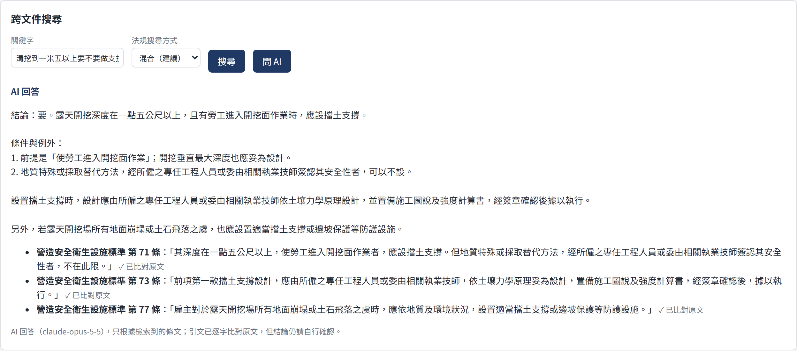
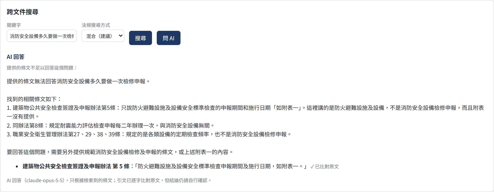
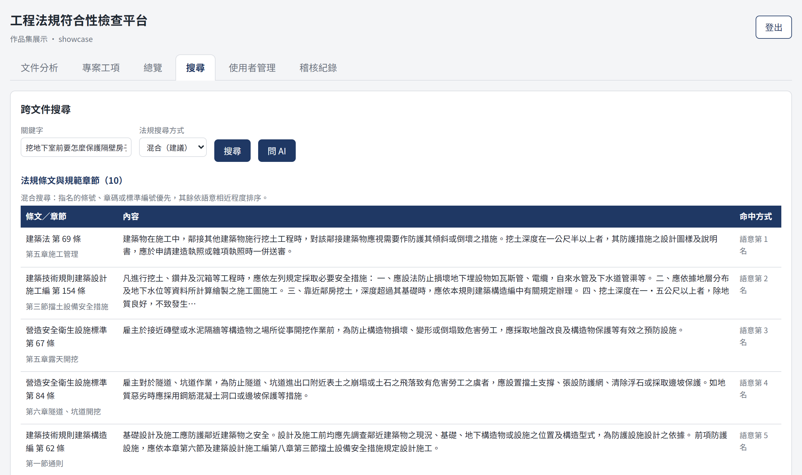
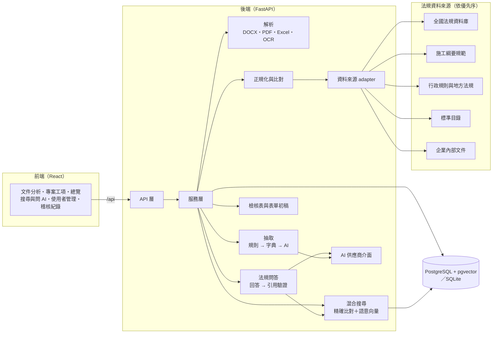

# 工程法規符合性檢查平台

[](https://github.com/kayla162/Engineering-Quality/actions/workflows/ci.yml)
[](LICENSE)

上傳工程文件，系統自動找出文件裡引用的法規、標準與規範，向官方資料庫查證它們現在是否有效，
再把工程的每一個工項對上它該依據的規範、契約與圖說，產出可稽核的報告與檢核表。
遇到不確定的規定，直接用口語問，系統會從法規條文裡找出答案並逐字附上出處。

**[線上 demo](https://engineering-quality.vercel.app/)** · [English summary](docs/portfolio-en.md)

---

## 解決什麼問題

一份公共工程的品質計畫、契約與施工規範，動輒引用上百部法規、標準與規範。品管與監造人員要逐一確認：

- **引用的法規還有效嗎？** 有沒有已經廢止、修正、更名，或寫成了簡稱、舊名、錯字？
- **CNS、ISO 這類標準引用的是最新版嗎？**
- **每一個工項都有依據嗎？** 標單上的工項，施工規範有沒有收錄、契約圖有沒有畫、該用哪一種工法？
- **品質計畫寫的標準，跟規範要求的一致嗎？**
- **現場遇到的問題，法規怎麼規定？**「溝挖多深要做支撐」「包商可以轉包嗎」，答案散在幾千條條文裡。

這些工作過去靠人工逐條翻查，耗時又容易漏。這個平台把它自動化：

| 人工作業 | 平台怎麼做 |
|---|---|
| 逐條找出文件引用了哪些法規 | 自動抽取，簡稱、舊名、文件編號都認得 |
| 一部一部上網查是否有效 | 對全國法規資料庫等官方來源批次查證，標出現行、已修正、已廢止 |
| 翻法規找某個規定寫在哪一條 | 用口語搜尋法規條文與施工規範章節，語意相近也找得到 |
| 讀條文、整理成答案 | 「問 AI」根據條文回答，每個規定都逐字引用並比對原文 |
| 對照標單、規範、契約圖 | 依計價代碼對上施工綱要規範章節，並找出相關的契約條文與圖號 |
| 從零撰寫表單與計畫 | 依本案規範產出品質管理標準表、自主檢查表、整體品質計畫等初稿 |
| 法規改版後回頭追蹤 | 定期同步官方資料，列出受影響的文件，一鍵重新分析 |

每一個判斷都附上「比對理由」，人工覆核後的結論獨立保存，整個過程可以回溯、可以稽核。

---

## 簡易動畫

<p align="center">
  
</p>

一份文件進來，依序經過六個階段：

1. **上傳文件**：Word、PDF、Excel、純文字都能收，掃描檔也行。
2. **解析與 OCR**：讀出文字與頁碼；沒有文字層的掃描頁自動 OCR。
3. **抽取引用**：規則引擎、別名字典、AI 三層接力，找出法規名稱、條號、標準編號、內部文件編號。
4. **比對查證**：向官方資料來源查詢，判定狀態並寫出比對理由。
5. **人工覆核**：確認或否決系統的判斷，覆核結果與系統判斷分開保存。
6. **報告與檢核表**：匯出 Excel、CSV、PDF 報告，以及工項檢核表與各式表單初稿。

**問 AI**（[線上 demo](https://engineering-quality.vercel.app/) 可直接點選試用，免登入）：用口語發問，回答的每個規定都附上逐字引用，並標示已比對原文（左）。
問題超出法規範圍時，系統會照實說明提供的條文不足以回答，不拿相近的條文硬套（右）。

<p align="center">
  
  
</p>

**語意搜尋**：用口語找條文，每筆結果標出是怎麼命中的（指名條號、語意第幾名）。

<p align="center">
  
</p>

---

## 用了哪些技術？以及為什麼？

| 技術 | 用在哪裡 | 為什麼選它 |
|---|---|---|
| **Python 3.12 + FastAPI** | 後端 API | 原生非同步，查詢外部來源、呼叫模型時不會卡住；型別提示直接產生 OpenAPI 文件（`/docs`） |
| **SQLAlchemy 2（async）+ Alembic** | 資料存取與資料庫版本控管 | 同一套程式同時支援 PostgreSQL 與 SQLite；每次結構變更都有可回溯的 migration |
| **PostgreSQL + pgvector** | 業務資料與法規條文向量 | 向量直接存在同一個資料庫，交易、備份、權限只有一套，搜尋結果能和法規主檔直接 join；HNSW 索引 |
| **SQLite** | 開發與測試 | 不必另外安裝資料庫就能跑，向量改在記憶體計算，和 PostgreSQL 走同一套查詢流程 |
| **sentence-transformers（BAAI/bge-m3）** | 法規條文的語意向量 | 本機執行的開源多語模型，繁體中文表現佳；文件不必送到外部服務，評估結果可重現 |
| **Anthropic Claude（Opus 5.5）** | 法規問答、抽取後援、模糊比對輔助、報告摘要 | 結構化輸出（JSON schema）讓回答與引用可以直接驗證；伺服器端 fallback；透過供應商介面接入，可替換或關閉 |
| **Pydantic v2** | 請求、回應與 AI 輸出的驗證 | 所有進出系統的資料都有明確結構，AI 的輸出也必須通過驗證才會被採用 |
| **PyMuPDF** | PDF 解析與 OCR | 速度快、能取得頁碼與文字位置；內建 Tesseract 介面，掃描檔 OCR 不需要額外安裝套件 |
| **python-docx、openpyxl、xlrd** | Word 與 Excel 讀寫 | 讀取契約、標單（含舊版 `.xls`），也用來產出 Word、Excel 格式的表單與計畫初稿 |
| **RapidFuzz** | 名稱相似度比對 | C 實作、速度快，大量名稱比對時仍然即時 |
| **ReportLab** | PDF 報告 | 可嵌入繁體中文字型，輸出的 PDF 在任何檢視器都不會亂碼 |
| **argon2** | 密碼雜湊 | 目前密碼雜湊的首選演算法，抗暴力破解 |
| **React 18 + TypeScript + Vite** | 前端 | 清單、篩選、詳細面板、覆核這類互動畫面適合 SPA；TypeScript 讓前後端的資料格式對得上 |
| **pytest、Vitest、Testing Library** | 測試 | 後端從單元、整合到 API 全鏈路；前端以使用者角度測試元件行為 |
| **Docker Compose + nginx** | 部署 | 一個指令啟動資料庫（含 pgvector）、後端、前端；nginx 負責靜態檔與 API 轉發 |
| **GitHub Actions** | 持續整合 | 每個 PR 自動跑後端、前端測試，並以 Docker 在 PostgreSQL 上完整啟動一次 |

---

## 架構



**後端分層**：每一層只做一件事，依賴只往下走。

```text
backend/app/
├── api/            路由與參數驗證，不含業務邏輯
├── services/       業務流程編排：分析、比對、檢核表、搜尋、問答、異動監控、稽核
├── repositories/   純資料存取
├── models/         資料表定義（SQLAlchemy）
├── schemas/        API 的請求與回應格式（Pydantic）
├── parsers/        DOCX、PDF、Excel、TXT 解析與 OCR
├── extractors/     抽取管線：規則引擎 → 別名字典 → AI 後援
├── matching/       名稱正規化與比對引擎
├── sources/        法規資料來源 adapter（可插拔、有優先序）
├── specs/          施工規範、契約、契約圖的讀取與檢核表初稿產生
├── search/         法規語料、embedding、混合搜尋、引用驗證、文件段落檢索
├── ai/             AI 供應商介面與實作、prompt 與版本
├── reports/        Excel、CSV、PDF 匯出
└── core/           設定、資料庫、權限、錯誤處理
```

**文件分析的資料流**：

```text
上傳 → 解析（含 OCR）→ 段落
     → 抽取（規則・字典・AI）→ 候選引用
     → 正規化（別名、文件編號）→ 標準名稱
     → 依優先序查詢資料來源 → 法規主檔
     → 比對引擎 → 狀態 + 信心分數 + 比對理由
     → 人工覆核 → 報告・檢核表・表單初稿
```

**問 AI 的資料流**：

```text
問題 → 混合搜尋（條號・章碼・標準編號精確比對 ＋ pgvector 語意向量）→ 前 8 條條文
     → Claude 只根據這 8 條回答，每個規定逐字引用（結構化輸出）
     → 程式逐條比對引文與原文 → 顯示回答與已驗證的引用
```

**多租戶**：每個帳號屬於一個租戶，文件、專案、企業內部文件、稽核紀錄都依租戶隔離。

---

## 工程亮點

三個以真實資料、先量測再改進的成果，每一個都有完整的評估方法與數據：

| 成果 | 數據 | 技術重點 |
|---|---|---|
| [引用可驗證的法規問答](docs/regulation-qa.md) | 保留測試集**錯誤答案 0**、陷阱題 **9/9 正確拒答**、答對率 50% → **75%** | RAG、逐字引用＋程式驗證、LLM 裁判與抽查、模型選型實驗 |
| [有評估的法規語意搜尋](docs/semantic-search.md) | 保留測試集 Recall@5 **0.54 → 0.91** | pgvector、混合搜尋、開發集／保留測試集分離、以數據選定架構 |
| [讓掃描契約圖對得上標單](docs/case-study-scanned-drawings.md) | 圖號辨識率 **35% → 92%**、待確認工項 **312 → 30** | OCR 前處理、多次投票、以索引表當白名單 |

### 引用可驗證的法規問答

「問 AI」根據檢索到的條文回答，每個規定都要逐字引用，再由程式比對原文驗證；只有通過驗證的回答才會顯示。

- **保留測試集**：錯誤答案 0 題、9 題刻意貼近主題的陷阱題全部正確拒答、引用 100% 逐字出自原文。
- **檢索決定問答品質**：同一個模型搭配混合搜尋，答對率由 50% 提升到 75%；正確條文沒被檢索到時，模型會說明查不到，而不是自行推測。
- **LLM 裁判**：以正確條文判斷回答是否正確、以被引用條文判斷有無超出條文的主張，裁判結果另行抽查。
- **模型選型實驗**：同題比較 Opus、Sonnet、Haiku 與不同 effort，逐筆檢查錯誤的性質後選定 Opus 5.5。
  法規答案會被照著執行，「應」與「得」這類義務用語必須精準。每題約 US$0.03、7 秒。
  完整過程見[案例說明](docs/regulation-qa.md)與[模型比較](docs/qa-model-comparison.md)。

### 有評估的法規語意搜尋

用自然語言找法規條文與施工規範章節：「溝挖到一米五以上要不要做支撐」找到營造安全衛生設施標準第 71 條。
條號、章碼、標準編號（「採購法第二十二條」「03310」「CNS 14253」）精確比對、排在最前面，其餘依語意排序。

- **向量存在既有的 PostgreSQL（pgvector）**，不另外架向量資料庫；embedding 用本機的 bge-m3。
- **以評估選定架構**：87 題標註正確答案的查詢，分開發集與架構定案後才撰寫的保留測試集；
  比較字詞相似度、純向量與多種混合方式後，選定「精確比對＋向量」。保留測試集 Recall@5 由 **0.54 提升到 0.91**。
- **上線與評估一致**：PostgreSQL 的查詢結果和評估腳本逐題比對，87 題前 5 名完全相同。
  完整過程見[案例說明](docs/semantic-search.md)。

### 可解釋的判斷，不做二元的「有效／無效」

工程文件裡的引用經常是簡稱、舊名或錯字，系統用六種狀態精確描述查到的結果：
現行有效、已修正、已廢止、疑似對應、查無此法規、查詢失敗。每一筆都附信心分數與比對理由，
說明「為什麼這樣判斷」，覆核的人一眼就能決定要不要採信。

### 可插拔的資料來源，官方資料永遠優先

所有資料來源實作同一個介面，依設定的順序查詢。排在前面的來源不會被後面的覆蓋，
官方資料永遠優先。目前已接上：

- **全國法規資料庫**：法務部 Open API，法律與法規命令約 11,800 筆。
- **公共工程施工綱要規範**：工程會技術雲，315 章。
- **行政規則與地方法規**、**CNS／ISO／ASTM 標準目錄**：依官方網站自動同步狀態、日期與版次。
- **企業內部文件**：各公司匯入自己的文件管制一覽表，品質手冊、程序書、文件編號都能比對。

### AI 是輔助，不是真相來源

抽取依序走規則引擎、別名字典，兩者都抽不到才交給 AI；模糊比對時 AI 只能微調分數、補充理由。
**法規是否有效只來自資料來源或人工覆核，AI 不會寫入法規狀態。**
問答的每一條引用都由程式比對原文。每一次 AI 呼叫都記錄模型、提示版本、輸入、輸出與 token 用量，
任何一筆判斷都能回溯。沒有 API key 時系統一樣完整運作。

### 讀得懂真實的工程文件

- **掃描檔**：沒有文字層的頁面自動 OCR，辨識出的段落會清楚標示。
- **契約圖**：讀取標題欄的圖號與圖名，CAD 匯出的圖靠文字位置、掃描的圖靠 OCR，並以圖號索引表校正。
  用印後掃描、沒有文字層的三冊契約圖（286 頁），圖號辨識率由 35% 提升到 92%：OCR 前擦掉框線、
  每頁讀多次投票，再以同冊的掃描索引表當白名單整冊決定，並檢查編號順序、補上夾在中間的頁；結構圖 32 頁逐頁核對全數正確。
- **圖與工項的對應**：圖名拆成「畫了什麼」（去掉樓層、圖種字，拆開「動力.插座」這類複合圖名），OCR 錯字用本案標單的用詞校正，
  再加上「開關箱畫在單線圖上」「粉刷貼磚畫在飾材配置圖上」「接地棒畫在避雷圖上」這類對照。秀山「標單有、契約圖沒有」由 312 筆收斂到 30 筆。
  完整過程見[案例說明](docs/case-study-scanned-drawings.md)。
- **標單**：支援舊版 `.xls`，依計價代碼前五碼直接對上施工綱要規範章節。
- 以秀山分隊的真實契約、規範（772 頁）、標單（1,028 個工項）與掃描契約圖校正讀取邏輯。

### 工項檢核表與表單初稿

每個工項自動對上：本案施工規範的章節與相關準則、契約條文、相關契約圖號、應選用的工法。
系統找出「標單有、契約圖沒有」、「契約圖有、標單沒有」、「工法未指定」這些需要注意的地方，
並依本案規範產出品質管理標準表、自主檢查表、監造抽查標準表、施工要領、設備功能運轉檢測表，
以及整體品質計畫、監造計畫的 Word 初稿。

### 法規異動監控

定期同步官方資料後，自動比對文件引用到的法規有沒有改版、廢止，列出受影響的文件，一鍵重新分析。
重新分析時，狀態沒變的引用保留原本的人工覆核，不必重做。Windows 工作排程器可每週自動執行。

### 安全與稽核

- 本機帳號採 argon2 雜湊，登入限流狀態存在資料庫，多個後端 worker 共用同一個時間窗。
- 租戶之間的資料完全隔離，連企業內部文件清單、跨文件搜尋都只看得到自己的。
- 全域稽核紀錄：誰在何時上傳、分析、覆核、匯出、管理帳號，以及每一次登入失敗。
- 送給模型的文件內容與使用者問題都包在明確的標籤裡，並要求模型忽略其中的指示，防範 prompt injection。

### 測試與品質把關

- 後端 900 多個測試，涵蓋單元、整合與 API 全鏈路；前端 130 多個元件與互動測試。
- **抽取準確度黃金測試集**：每次修改都計算召回率與精確率，退步就擋下。
- **搜尋與問答評估腳本**：一個指令重跑全部評估；模型回應快取在磁碟，重算指標不必再花費，`--dry-run` 先估算費用。
- 每個 PR 由 GitHub Actions 自動執行全部測試，並用 Docker 在 PostgreSQL 上完整啟動一次。

---

## 快速開始

### 方式一：Docker

```bash
cp .env.example .env && docker compose up --build
```

開啟 <http://localhost:3000>。後端 API 文件在 <http://localhost:8000/docs>。容器啟動時會自動建立資料表並載入種子資料。

建立第一位管理員（會要求輸入至少 12 個字元的密碼）：

```bash
docker compose exec backend python scripts/bootstrap_admin.py --tenant-name "預設租戶" --username admin
```

### 方式二：本機開發

需要 Python 3.12 與 Node.js 22 以上。

```bash
python -m venv .venv
.venv/Scripts/pip install -r requirements.txt   # Linux / macOS 用 .venv/bin/pip
cp .env.example .env                            # DATABASE_URL 可改成 sqlite+aiosqlite:///./data/app.db
.venv/Scripts/python -m alembic upgrade head
.venv/Scripts/python scripts/bootstrap_admin.py --tenant-name "預設租戶" --username admin
.venv/Scripts/python scripts/seed_data.py
.venv/Scripts/python -m uvicorn app.main:app --app-dir backend --reload
```

另開一個終端機啟動前端：

```bash
npm install --prefix frontend && npm run dev --prefix frontend
```

開啟 <http://localhost:5173>。

### 接上官方法規資料

```bash
python scripts/sync_taiwan_law.py --keep-raw   # 全國法規資料庫（--keep-raw 保留條文全文，語意搜尋會用到）
python scripts/sync_pcces.py                   # 公共工程施工綱要規範
python scripts/sync_catalogs.py                # 行政規則與標準目錄
```

在 `.env` 設定 `REGULATION_SOURCES=taiwan_law,pcces,admin_rules,standards_demo,enterprise`（順序即優先序）。

### 啟用語意搜尋與問 AI

```bash
pip install -r requirements-semantic.txt       # sentence-transformers（bge-m3）
python scripts/build_search_index.py           # 建立法規條文與規範章節的向量索引
```

在 `.env` 設定 `EMBEDDING_PROVIDER=local`，並填入 `ANTHROPIC_API_KEY`，「搜尋」分頁就會使用混合搜尋與「問 AI」。
問答的模型與 effort 可用 `QA_MODEL`、`QA_EFFORT` 調整。

### 一次看完所有功能

```bash
python scripts/generate_full_demo.py
python scripts/seed_full_demo.py --username <帳號> --password <密碼>
```

建立一個包含標單、施工規範、契約、需求書、契約圖與整體品質計畫的示範專案，檢核表的每一種結果都看得到。

### 執行測試與評估

```bash
.venv/Scripts/python -m pytest                          # 後端
npm test --prefix frontend                              # 前端
python scripts/eval_search.py                           # 語意搜尋評估（Recall@5、Hit@1、MRR）
python scripts/eval_qa.py --sets dev test --dry-run     # 法規問答評估：先估算費用
python scripts/eval_qa.py --sets dev test               # 法規問答評估
python scripts/eval_qa.py --compare --sets dev test     # 模型與 effort 比較
```

---

## 深入閱讀

| 文件 | 內容 |
|---|---|
| [線上 demo](https://engineering-quality.vercel.app/) | 搜尋與問 AI 的靜態展示版：13 題預設問題（含陷阱題），回答是評估時的真實模型輸出 |
| [English summary](docs/portfolio-en.md) | 專案與三個成果的英文摘要 |
| [案例：引用可驗證的法規問答](docs/regulation-qa.md) | 逐字引用與程式驗證、陷阱題、LLM 裁判與抽查、檢索品質對答案的影響、模型選型 |
| [案例：有評估的法規語意搜尋](docs/semantic-search.md) | pgvector 架構取捨、評估方法、Recall@5 0.54 → 0.91、以數據選定架構的過程 |
| [案例：讓掃描契約圖對得上標單](docs/case-study-scanned-drawings.md) | 圖號辨識率 35% → 92%、「標單有、契約圖沒有」312 → 30 的量測與設計取捨 |
| [問答評估結果](docs/qa-eval-results.md)、[模型比較](docs/qa-model-comparison.md)、[搜尋評估結果](docs/search-eval-results.md) | 評估腳本產生的完整數據 |
| [完整操作手冊](docs/guide.md) | 每個功能的詳細操作、設定項目與實測紀錄 |
| [系統架構](docs/architecture.md) | 分層設計、模組職責、AI 的角色與界線 |
| [資料庫設計](docs/database.md) | 資料表、欄位與列舉值定義 |
| [API 文件](docs/api.md) | 每支 API 的參數、回應格式與錯誤碼 |
| [開發計畫](docs/development-plan.md) | 各階段的目標與完成狀態 |
| [設計規格](docs/superpowers/specs/) | 工項檢核表、登入與租戶隔離等功能的設計文件 |
| [`.env.example`](.env.example) | 所有設定項目與說明 |

---

## 授權

本專案原始碼採用 [MIT 授權](LICENSE)：可以自由使用、修改、散布與商業利用，只需保留原始的版權與授權聲明。

本專案使用的公開資料與模型不在 MIT 授權範圍內，依各自的授權條款使用：

- **全國法規資料庫**：法務部，依[政府資料開放授權條款第 1 版](https://data.gov.tw/license)提供，引用時須註明「資料來源：法務部全國法規資料庫」。
- **公共工程施工綱要規範**：行政院公共工程委員會，公共工程雲端服務網（技術雲）。
- **CNS 國家標準**：經濟部標準檢驗局 CNS 網路服務系統（系統只記錄標準編號、名稱與版次，不含標準內容）。
- **BAAI/bge-m3**：語意搜尋使用的 embedding 模型，由使用者自行下載，依其模型授權使用。
