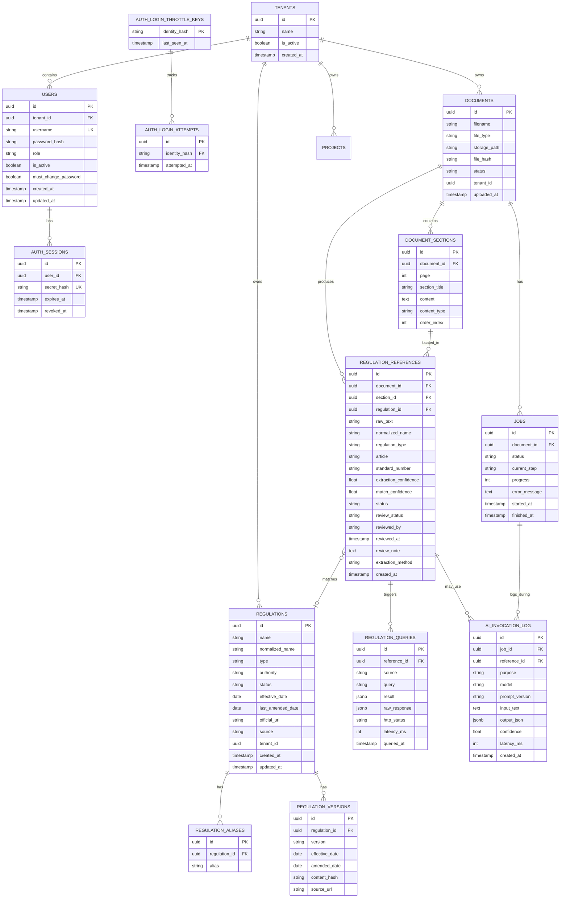

# 資料庫設計（Phase 0）

資料庫：PostgreSQL 15+
ORM：SQLAlchemy 2.0 + Alembic（`migrations/`）

本文件在需求書第十三節的基礎上，新增分析與稽核資料表、人工覆核欄位，以及本機登入和租戶隔離所需資料。文件、專案與法規資料各屬於一個租戶；由文件或專案衍生的資料沿外鍵回到租戶根資料。

---

## 1. ERD 總覽

---

## 2. 資料表定義

### 2.1 `documents`

| 欄位 | 型別 | 說明 |
|---|---|---|
| id | UUID PK | |
| filename | VARCHAR | 原始檔名 |
| file_type | VARCHAR | docx / pdf / txt |
| storage_path | VARCHAR | 實際儲存路徑（與原始檔名分離） |
| file_hash | VARCHAR(64) | SHA-256，用於去重與完整性驗證 |
| status | VARCHAR | `UPLOADED / PARSING / PARSED / ANALYZING / ANALYZED / FAILED` |
| tenant_id | UUID FK → tenants, required | 所屬租戶 |
| uploaded_at | TIMESTAMPTZ | |

索引：`(tenant_id, file_hash)`（唯一，租戶內去重）、`tenant_id`。

### 2.0 `tenants`、`users`、`auth_sessions`

Migration `0006` 建立預設租戶並將既有文件、專案、法規資料歸入該租戶。首位管理員由 `scripts/bootstrap_admin.py` 互動建立；資料庫只保存 Argon2 密碼雜湊。瀏覽器 cookie 保存隨機 session secret，`auth_sessions` 只保存其 SHA-256 雜湊和到期／撤銷時間。若不同租戶已上傳相同檔案，downgrade 會停止，避免恢復全域唯一約束時破壞資料。

使用者名稱全域唯一，以正規化後的小寫格式保存。角色為 `tenant_admin` 或 `member`；管理員新增的成員首次登入必須更改初始密碼。

管理員忘記密碼時，具資料庫操作權限的部署人員可執行 `scripts/reset_user_password.py` 互動式重設；密碼只保存 Argon2 雜湊，使用者下次登入必須更改，所有既有 session 會撤銷。重設不會啟用停用帳號。

Migration `0007` 建立 `auth_login_throttle_keys` 與 `auth_login_attempts`，在資料庫共享登入嘗試狀態。識別雜湊和時間戳只保留目前限流視窗；SQLite 寫入會序列化，正式多 worker 部署使用 PostgreSQL。

### 2.2 `document_sections`

| 欄位 | 型別 | 說明 |
|---|---|---|
| id | UUID PK | |
| document_id | UUID FK → documents | |
| page | INT | 頁碼（表格/圖片段落可為 NULL） |
| section_title | VARCHAR, nullable | 標題（若解析器能辨識） |
| content | TEXT | 原始文字 |
| content_type | VARCHAR | `paragraph / heading / table / cell` |
| order_index | INT | 在文件中的順序，供前端還原原始文件排列 |

索引：`document_id, order_index`。

### 2.3 `jobs`（新增）

| 欄位 | 型別 | 說明 |
|---|---|---|
| id | UUID PK | |
| document_id | UUID FK → documents | |
| status | VARCHAR | `PENDING / PROCESSING / COMPLETED / FAILED` |
| current_step | VARCHAR | `PARSING / EXTRACTING / NORMALIZING / MATCHING / QUERYING / REPORTING` |
| progress | INT | 0–100 |
| error_message | TEXT, nullable | |
| started_at | TIMESTAMPTZ | |
| finished_at | TIMESTAMPTZ, nullable | |

一份文件可以有多筆 `jobs`（重新分析時新增一筆，而非覆蓋），保留每次分析的歷史紀錄，滿足「可追溯」原則。

### 2.4 `regulation_references`

| 欄位 | 型別 | 說明 |
|---|---|---|
| id | UUID PK | |
| document_id | UUID FK → documents | |
| section_id | UUID FK → document_sections | |
| regulation_id | UUID FK → regulations, nullable | 比對成功才會有值 |
| raw_text | VARCHAR | 文件中出現的原始文字 |
| normalized_name | VARCHAR, nullable | 正規化後名稱 |
| regulation_type | VARCHAR | `law / regulation / standard(CNS/ISO/ASTM/JIS) / engineering_spec / contract_spec / announcement / other` |
| article | VARCHAR, nullable | 條號 |
| standard_number | VARCHAR, nullable | 標準編號 |
| extraction_confidence | FLOAT | 抽取階段信心分數（規則=1.0，NER=依模型，LLM=依回傳） |
| match_confidence | FLOAT, nullable | 比對階段信心分數 |
| status | VARCHAR | 見第 3 節「法規狀態列舉」 |
| review_status | VARCHAR | `UNREVIEWED（預設） / CONFIRMED / REJECTED`（新增，人工覆核） |
| reviewed_by | VARCHAR, nullable | 執行覆核之登入使用者名稱（由 session 推導，不接受客戶端指定） |
| reviewed_at | TIMESTAMPTZ, nullable | |
| review_note | TEXT, nullable | |
| extraction_method | VARCHAR | `regex / dictionary / ner / llm_fallback`，記錄這筆是哪一層抽出來的 |
| created_at | TIMESTAMPTZ | |

索引：`document_id`、`regulation_id`、`status`、`review_status`。

### 2.5 `regulations`

| 欄位 | 型別 | 說明 |
|---|---|---|
| id | UUID PK | |
| name | VARCHAR | 官方全名 |
| normalized_name | VARCHAR | 內部正規化名稱（用於比對） |
| type | VARCHAR | 同上 `regulation_type` 列舉 |
| authority | VARCHAR, nullable | 發布機關 |
| status | VARCHAR | 見第 3 節 |
| effective_date | DATE, nullable | |
| last_amended_date | DATE, nullable | |
| official_url | VARCHAR, nullable | |
| source | VARCHAR | 最後一次確認資料的來源名稱（對應 `sources/` adapter 的 `source_name`），或 `manual`（人工建立） |
| tenant_id | UUID FK → tenants, required | 所屬租戶；本階段法規目錄依租戶隔離 |
| created_at / updated_at | TIMESTAMPTZ | |

索引：`normalized_name`（供比對查詢）、`type`、`status`。

### 2.6 `regulation_aliases`

| 欄位 | 型別 | 說明 |
|---|---|---|
| id | UUID PK | |
| regulation_id | UUID FK → regulations | |
| alias | VARCHAR | |

唯一約束：`(regulation_id, alias)`。

### 2.7 `regulation_versions`

| 欄位 | 型別 | 說明 |
|---|---|---|
| id | UUID PK | |
| regulation_id | UUID FK → regulations | |
| version | VARCHAR | |
| effective_date | DATE, nullable | |
| amended_date | DATE, nullable | |
| content_hash | VARCHAR, nullable | 用於偵測條文內容是否變動 |
| source_url | VARCHAR, nullable | |

### 2.8 `regulation_queries`

| 欄位 | 型別 | 說明 |
|---|---|---|
| id | UUID PK | |
| reference_id | UUID FK → regulation_references | |
| source | VARCHAR | adapter 名稱 |
| query | VARCHAR | 送出的查詢字串 |
| result | JSONB | 轉換成統一格式後的結果 |
| raw_response | JSONB, nullable | 原始回傳（除錯與稽核用） |
| http_status | VARCHAR, nullable | |
| latency_ms | INT, nullable | |
| queried_at | TIMESTAMPTZ | |

### 2.9 `ai_invocation_log`（新增）

| 欄位 | 型別 | 說明 |
|---|---|---|
| id | UUID PK | |
| job_id | UUID FK → jobs, nullable | |
| reference_id | UUID FK → regulation_references, nullable | |
| purpose | VARCHAR | `extraction / similarity_judgement / report_summary` |
| model | VARCHAR | 例如 `claude-sonnet-5` |
| prompt_version | VARCHAR | 例如 `extractor_v1` |
| input_text | TEXT | |
| output_json | JSONB | |
| confidence | FLOAT, nullable | |
| latency_ms | INT, nullable | |
| created_at | TIMESTAMPTZ | |

---

## 3. 列舉值定義

**`regulations.status` / `regulation_references.status`（法規狀態）**

| 值 | 說明 |
|---|---|
| `ACTIVE` | 現行有效 |
| `AMENDED` | 已修正（仍有效，但版本已變動） |
| `REPEALED` | 已廢止 |
| `NOT_FOUND` | 查無此法規/標準 |
| `POSSIBLE_MATCH` | 找到疑似對應但信心不足，需人工確認 |
| `UNKNOWN` | 查詢失敗或尚未查詢 |

**`regulation_references.review_status`（人工覆核狀態，新增）**

| 值 | 說明 |
|---|---|
| `UNREVIEWED` | 尚未人工覆核（預設） |
| `CONFIRMED` | 人工已確認系統判斷正確 |
| `REJECTED` | 人工判定系統判斷錯誤（連動觸發重新比對或人工指定正確法規） |

**`jobs.status`**：`PENDING / PROCESSING / COMPLETED / FAILED`

**`documents.status`**：`UPLOADED / PARSING / PARSED / ANALYZING / ANALYZED / FAILED`

---

## 4. 為什麼不是「有效/無效」二元判斷

延續你需求書第九節的要求：工程文件裡的引用經常是「名稱寫錯字」「舊名稱」「同名不同版」「根本查無此規範」，二元判斷會掩蓋這些落差。上述六種狀態讓報告可以誠實反映「系統目前確定知道什麼、不確定什麼」，並且明確標出「需要人看」的項目（`POSSIBLE_MATCH`、`NOT_FOUND`、`UNKNOWN`），這比一個看似肯定但可能誤導的「有效/無效」更符合企業實際查核的需求。

---

## 5. Migration 策略

- 使用 Alembic 管理所有 schema 變更，`migrations/` 目錄下每個 migration 對應一個語意化訊息（例如 `0001_initial_schema`、`0002_add_jobs_table`）。
- MVP 階段的種子資料（`MockRegulationSource` 的假資料、常見法規別名字典的初始版本）透過 `scripts/seed_data.py` 載入，不寫死在 migration 裡，方便日後替換。
